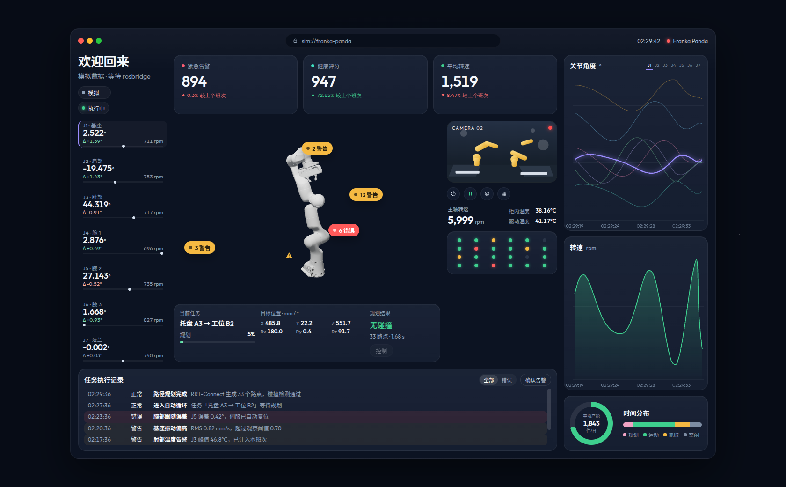

# Robot Monitoring Interface

Franka Panda 监控控制台。页面按工业监控台的深色版面组织：连接与运行状态、七个关节角度、当前任务、目标位姿和执行记录放在同一块工位窗口里，曲线用 ECharts 实时绘制。

浏览器不能直接加入 ROS 2 的 DDS。页面通过 rosbridge 的 WebSocket 读取已经在跑的 Gazebo / MoveIt；连不上时继续用模拟循环。连上后可以下发关节轨迹、就绪位和 MoveIt 末端目标。



## 运行页面

```bash
npm install
npm run dev
```

开发服务器在 [http://127.0.0.1:47321](http://127.0.0.1:47321)。

Windows 上如果在 WSL 里执行 `npm` 却走到了 Windows 的 npm，请改在 PowerShell 里进入克隆目录再启动：

```powershell
cd C:\Users\Lenovo\roboview
npm install
npm run dev
```

## 接到 Gazebo 和 MoveIt

在已经 `source` 过 ROS 2 和工作空间、并且 Gazebo 与 MoveIt 正在运行的那个终端里启动 rosbridge。`ROS_DOMAIN_ID` 必须和仿真一致。

```bash
sudo apt install ros-$ROS_DISTRO-rosbridge-suite
source /opt/ros/$ROS_DISTRO/setup.bash
ros2 launch rosbridge_server rosbridge_websocket_launch.xml
```

默认地址是 `ws://127.0.0.1:9090`。WSL2 里启动时，Windows 浏览器可以用同一个地址。换地址时打开 `http://127.0.0.1:47321/?ros=ws://127.0.0.1:9090`，或在启动前设置 `VITE_ROSBRIDGE_URL`。加上 `?ros=off` 则只跑模拟数据。

页面订阅这些话题：

| 页面 | 话题 |
| --- | --- |
| 关节角度、转速 | `/joint_states`（`panda_joint1` … `panda_joint7`，弧度换算成角度；力矩为 NaN 时忽略） |
| 运行状态 | `/move_action/_action/status`、`/panda_arm_controller/follow_joint_trajectory/_action/status` |
| 规划路点与时长 | `/display_planned_path` |
| 目标位姿 | `/tf`、`/tf_static`（`panda_hand` / `panda_link8` / `panda_grasptarget`） |
| 当前错误 | 动作失败、中止，或 `/rosout` 的最新一条 ERROR。旧错误不累加，点「恢复」、动作开始或成功后清除 |
| 错误记录 | 底部执行记录保留历史；`/rosout` 的 WARN 及以上都会写入 |

`/display_planned_path` 有的发布端是 `TRANSIENT_LOCAL`。页面按 `VOLATILE` 订阅，这样才能同时连上其余发布端。请在页面显示「已连接」之后再做一次规划，路点才会出现。

左上角「模拟」表示还在用页面内的循环。点它会重试 rosbridge；连上后变成「已连接」，再点一次切回模拟。

手臂外形使用项目里的 Panda 网格，材质按 Gazebo 里的浅灰外壳，不使用 RViz 的橙色贴图。关节角和 Gazebo 共用 `/joint_states`。如果本机还有 Gazebo Fuel 缓存，开发服务器会优先用那一份。Windows 上从 PowerShell 启动时，会通过 WSL 找到：

`~/.gz/fuel/fuel.ignitionrobotics.org/openrobotics/models/panda with ignition position controller model/5`

项目自带的网格在 `public/panda-model`。只有这份文件也读不到时，页面才显示原来的示意图。已连接和模拟用的是同一套外形。也可以在启动前设置 `PANDA_MODEL_DIR` 指向 Fuel 缓存。

当前位姿来自 `panda_link0` → `panda_hand`。这台 Panda 没有夹爪动作，页面不下发夹爪。

连上之后，规划结果旁的「控制」可以：

- 指定关节：把七个目标角度发给 `/panda_arm_controller/follow_joint_trajectory`，超出软限位不会下发
- 初始姿态：Franka 常用初始位（J4 为 -135°，不是全零）
- 规划执行：末端目标按 `panda_link0` 填写，下发前用 TF 换到 MoveIt 的规划坐标系 `world`，再发给 `/move_action`（规划组 `panda_arm`）。还没收到 `world` → `panda_link0` 时不会下发
- 停止：调用关节控制器和 MoveIt 的 `cancel_goal`。服务没接受时页面会写明停止失败，而不是只改成本地「已停止」

速度比例是 0.2。关节目标超出软限位时不会下发。

## 技术

- Vue 3 + TypeScript + Vite
- ECharts 绘制关节角度与转速
- rosbridge JSON WebSocket，不依赖 roslib

## 可以点的地方

- 左上角连接胶囊：接入 rosbridge 或切回模拟
- 关节行或曲线图上的 J1–J7 切换高亮轴
- 相机按钮：电源（同一连接开关）、暂停、抓拍、网格
- 执行记录可只看错误，并确认告警
