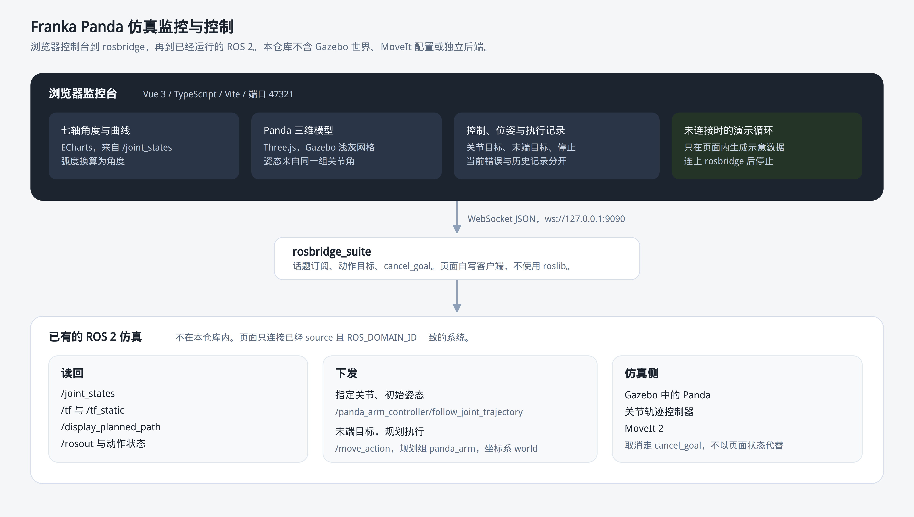
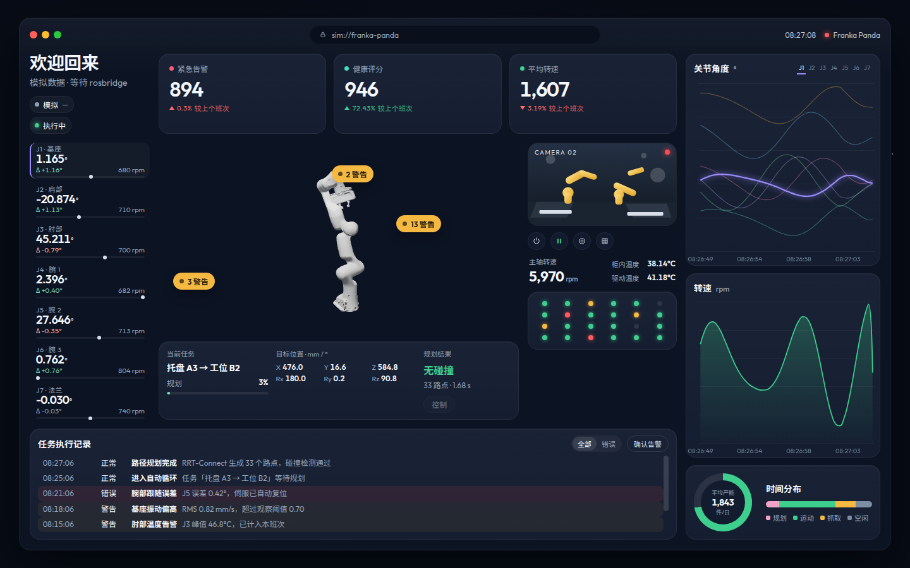
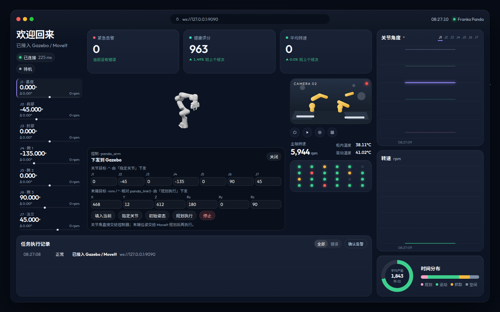

# Franka Panda 仿真监控与控制

浏览器里的七轴监控台。它读取已经在运行的 Gazebo / MoveIt，下发关节目标或末端目标，并把规划与执行结果写回同一页面。本仓库是这个前端，不含 Gazebo 世界、MoveIt 配置，也没有单独的机器人后端。

## 系统架构



数据分两条：

- 读回：`/joint_states`、`/tf`、`/tf_static`、`/display_planned_path`、`/rosout`，以及关节控制器和 MoveIt 的动作状态。
- 下发：关节角走 `/panda_arm_controller/follow_joint_trajectory`；末端位姿走 `/move_action`。停止时调用两边的 `cancel_goal`。

未连上 rosbridge 时，页面用内部循环保持监控台可看。左上角显示「已连接」之后，这条循环停掉，关节角、位姿和规划结果改为上面的 ROS 数据。

## 关键技术

- **rosbridge，而不是 DDS。** 浏览器不能加入 ROS 2 的 DDS。页面用自写的 JSON WebSocket 客户端连接 `ws://127.0.0.1:9090`，完成订阅、动作目标和服务调用，不依赖 roslib。
- **两条下发路径分开。** 「指定关节」和「初始姿态」只发七个角度，不看末端数字。「规划执行」只发末端位姿，不看关节输入框。初始姿态使用 Franka 常用角度，J4 为 -135°。
- **末端目标先换到规划坐标系。** 页面上的位姿保持在 `panda_link0`。发给 MoveIt 之前，沿 TF 把该位姿变到模型坐标系 `world`。链路还没到时拒绝下发。
- **结果以控制器返回为准。** 规划路点和时长来自 `/display_planned_path`。完成、失败、中止和取消来自动作状态与返回码。MoveIt 成功码是 1，关节轨迹成功码是 0。末端已经在目标上，或返回成功但关节没有动时，页面写明没有发生运动。
- **软限位在下发前检查。** 超出 `panda_joint1` 到 `panda_joint7` 的软限位不会发给控制器。
- **模型和仿真外观对齐。** Three.js 加载 Panda 网格，材质按 Gazebo 的浅灰外壳，不用 RViz 的橙色贴图。相机按当前姿态的包围球取景，手臂伸出后仍留在窗口内。
- **当前错误和历史记录分开。** 横幅和腕部标记只表示当前这一条错误。底部执行记录保留本次连接里的历史。

页面没有机器人用的 HTTP API。CAMERA 02 是固定示意图，不读取相机话题。这台 Panda 的页面不下发夹爪。

## 项目截图

监控台。未连接 rosbridge 时，关节角和模型由页面内循环驱动。底部记录里的规划字样也来自这个循环，不是本项目实现的规划算法，也不是 MoveIt 的返回：



连上 rosbridge 后的控制面板。表单在模型下方，不遮住三维窗口：



## 演示视频

[监控台演示](demo-console.mp4)

这段视频是未连接 rosbridge 时的监控台：关节角、三维模型和曲线在页面内更新，点击左侧关节会高亮对应曲线。控制面板见上一张截图。视频没有驱动 Gazebo 里的机械臂；真实的规划与执行用下面的启动步骤，在本机 Gazebo 和 MoveIt 已经运行时操作。

## 代码

公开仓库：<https://github.com/xgshing/robot-monitoring-interface>

| 路径 | 作用 |
| --- | --- |
| `src/App.vue` | 整页布局、连接状态 |
| `src/components/PandaArm.vue` | 三维模型 |
| `src/components/RobotStage.vue` | 模型、任务和位姿 |
| `src/components/CommandDock.vue` | 关节目标与末端目标 |
| `src/composables/useRosLive.ts` | 订阅、下发、取消和结果判断 |
| `src/ros/rosbridge.ts` | WebSocket 客户端 |
| `src/ros/goals.ts` | 轨迹与 MoveIt 目标 |
| `src/ros/parse.ts` | 关节、TF、规划和日志解析 |
| `public/panda-model` | 页面自带的 Panda 网格 |

## 可复现的启动步骤

需要本机已经能启动 Gazebo 里的 Franka Panda 和 MoveIt 2，并且浏览器能访问该机器的 `9090` 和 `47321` 端口。下面用 ROS 2 Jazzy 的写法；发行版不同时，把 `jazzy` 换成实际名称。

1. 在仿真终端里启动现有的 Gazebo 与 MoveIt，并记住它的 `ROS_DOMAIN_ID`。本仓库不提供这份启动文件。
2. 再开一个终端，启动 rosbridge。域名必须和仿真相同。

```bash
source /opt/ros/jazzy/setup.bash
export ROS_DOMAIN_ID=0
sudo apt install ros-jazzy-rosbridge-suite
ros2 launch rosbridge_server rosbridge_websocket_launch.xml
```

3. 在项目目录启动页面。

```bash
npm install
npm run dev
```

4. 打开 <http://127.0.0.1:47321>。左上角变为「已连接」，左侧角度应随 Gazebo 里的 `/joint_states` 变化。换地址时使用 `http://127.0.0.1:47321/?ros=ws://127.0.0.1:9090`。只看页面内演示时打开 `http://127.0.0.1:47321/?ros=off`。
5. 确认可以下发：
   - 「控制」→「初始姿态」或「指定关节」：七个角度发给关节控制器，模型跟着 `/joint_states` 动。
   - 「控制」→ 修改末端的 X Y Z Rx Ry Rz →「规划执行」：MoveIt 规划并执行。路点数出现在记录里，成功或失败出现在面板说明中。
   - 「停止」：取消被接受后页面写明「控制器已接受取消」。没有接受时写明停止失败。
